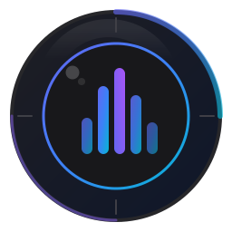
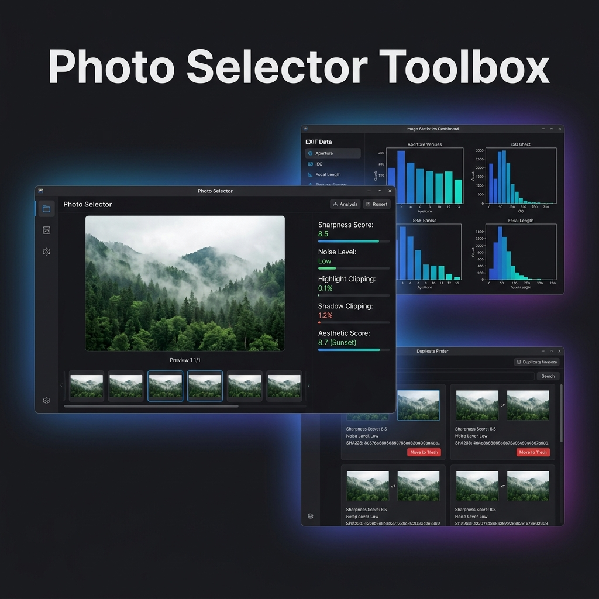
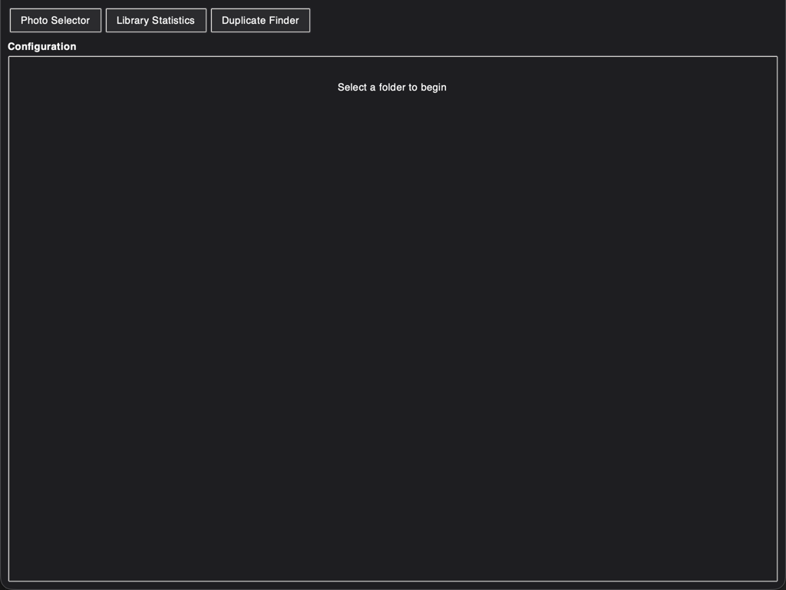
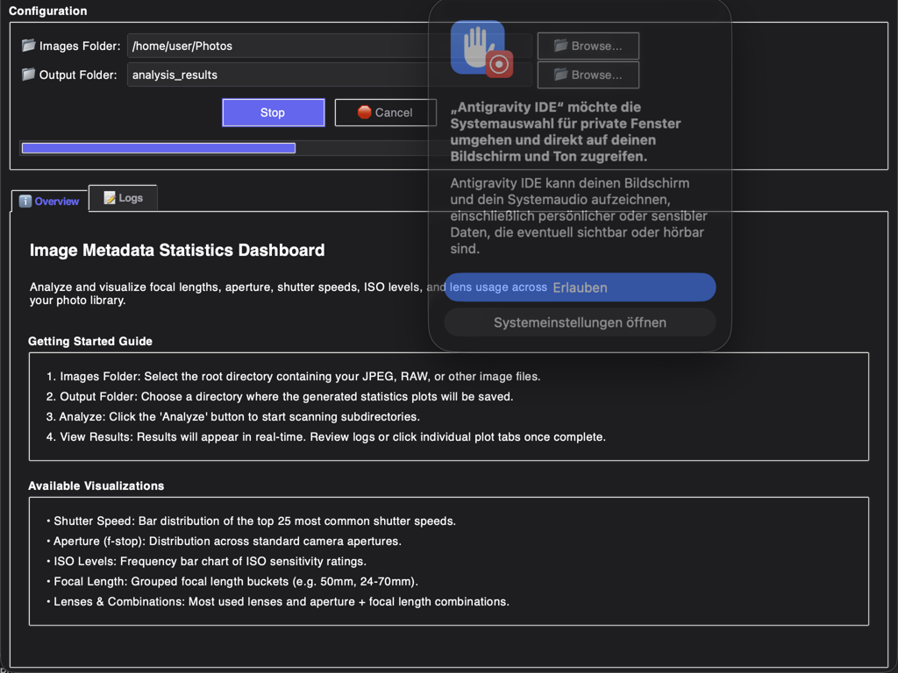
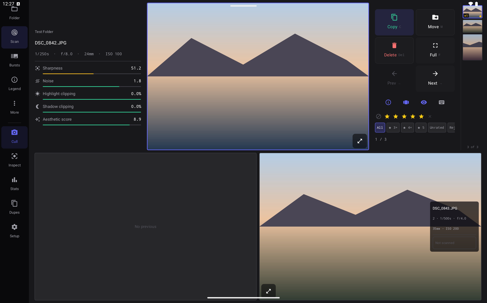

<div align="center">
  

  # Photo Selector Toolbox

  **The ultimate multi-platform ecosystem to cull, analyze, and organize your photo libraries with blazing speed — built for Desktop, Tablet, and Mobile.**

  [](LICENSE)
  [](https://www.python.org/)
  [](https://swift.org/)
  [](https://kotlinlang.org/)
  [](https://github.com/alexpp90/homebrew-photo-selector-toolbox/actions)
  [](https://github.com/alexpp90/homebrew-photo-selector-toolbox/releases/latest)
  [](#-desktop-installation)
  [](#-desktop-installation)
  [](#-desktop-installation)
  [](#-android-installation)

  <br />
  
</div>

---

## 🌟 The Ecosystem at a Glance

**Photo Selector Toolbox** is a privacy-first, high-velocity photo culling and metadata analysis suite designed for professional photographers, enthusiasts, and creators. Whether you are at your desktop workstation, reviewing on a tablet, or sorting on the go with your phone, we have a native solution tailored to your workflow.

> 🔒 **100% Private & Offline:** Your photos never leave your device. All EXIF parsing, duplicate detection, and quality evaluations (including local AI models) run strictly on-device. No cloud uploads, no subscriptions, no telemetry.

---

## 📦 Five Products, One Shared Repository

The repository ships five products (four active native solutions alongside the archived legacy Desktop), each optimized for its environment and UX model. They share photographic *concepts* — the EXIF contract, score semantics, what "Selection" means — and, between the two Android products, one small library module. They do not share implementations.

| Product | Code | Tech Stack | Target Environment | Primary UX Paradigm | Docs |
| :--- | :--- | :--- | :--- | :--- | :--- |
| **Desktop** | `products/desktop/src/` | Python 3.10+, Tkinter, OpenCV, rawpy | macOS, Windows, Linux | Menu & keyboard-driven, split view | [docs](docs/products/desktop/README.md) |
| **macOS Desktop** | `products/macos-desktop/` | Swift 6, SwiftUI, Vision, Accelerate | macOS 14+ / 15+ Apple Silicon & Intel | Maximized preview, sliding triplet focus, zero-latency hotkeys | [docs](docs/products/macos-desktop/README.md) |
| **Linux Desktop** | `products/linux-desktop/` | Python 3.12+, GTK4, Libadwaita | Debian 13 (Trixie), GNOME 46+ | Studio dark, Libadwaita HeaderBar, tactile shortcuts | [docs](docs/products/linux-desktop/README.md) |
| **Android Desktop** | `products/android/android-desktop/` (`:android-desktop`) | Kotlin, Compose, Room, OpenCV, Vico | Samsung DeX, large tablets ($\ge 840$dp) | Mouse, keyboard & multi-pane touch | [docs](docs/products/android-desktop/README.md) |
| **PhotoTok** | `products/android/phototok/` (`:phototok`) | Kotlin, Compose, DataStore (lightweight) | Portrait phones ($< 600$dp) | Swipe-centric, gesture-first | [docs](docs/products/phototok/README.md) |
| *(shared library)* | `products/android/core/` (`:core`) | Kotlin | — | EXIF model + readers used by both Android products | [docs](docs/shared/README.md) |

Naming matters here — "the Android app" is ambiguous. Canonical names, slugs and their mapping to Gradle modules and package identifiers: [`docs/GLOSSARY.md`](docs/GLOSSARY.md).

### Repository map

All product code lives under `products/`, one directory per product, the same shape in each:
`src/` for sources, `tests/` for tests, its own build configuration, its own `README.md`.
Everything else at the root is genuinely shared.

```
products/                  ALL product code
  desktop/                   Desktop         — src/ tests/ benchmarks/ scripts/ pyproject.toml
  macos-desktop/             macOS Desktop   — src/ tests/ Package.swift
  linux-desktop/             Linux Desktop   — src/ tests/ debian/ scripts/ pyproject.toml (planned)
  android/                   Gradle build root for both Android products
    android-desktop/           Android Desktop — src/ tests/ res/ AndroidManifest.xml
    phototok/                  PhotoTok        — src/ tests/ res/ AndroidManifest.xml
    core/                      :core — the only code the two Android products share
docs/                      Product documentation, per product      -> docs/README.md
ai/                        AI agent framework: routing, agents, skills, memory -> ai/README.md
scripts/                   Cross-product tooling — run_tests.sh (the local CI mirror)
assets/                    Shared branding
Formula/  Casks/           Homebrew tap definitions (must stay at the root — brew tap
                           only looks here)
```

The layout rules, and why `android/` groups two products, are in
[`products/README.md`](products/README.md).

---

## 💻 1. Desktop Culling Suite (Python)

A full-featured Python command-line utility and custom Tkinter graphical interface optimized for high-throughput desktop curation.

<div align="center">
  
  <p><em>The clean, zinc-themed Desktop workspace in its initial state</em></p>
  
  <p><em>Interactive Library Statistics and EXIF histograms integrated into the dark theme</em></p>
</div>

### Key Features
*   **Dynamic Review Layouts:** Toggle between **Standard** mode (Current image on top, Previous/Next images side-by-side) and **Focus** mode (Current image and Controls split top, Previous/Next split bottom).
*   **Aesthetic & Quality Algorithms:**
    *   **Sharpness Score:** Crops the center 50% of the image, divides it into an 8x8 grid, and calculates the maximum block variance of the Laplacian filter.
    *   **Noise Level:** Estimates noise via Median Absolute Deviation (MAD) of the Laplacian filter:
        $$\sigma = \frac{\text{median}(|\nabla^2 I - \text{median}(\nabla^2 I)|)}{0.6745}$$
    *   **Highlight & Shadow Clipping:** Grayscale pixel thresholds highlighting blown highlights ($\ge 254$) and crushed shadows ($\le 2$).
    *   **Ollama AI Vision Integration:** Offline local VLM scoring ($1.0 - 10.0$) and analysis tags (e.g. `[ANALYSIS: Portrait]`) using base64-encoded $400 \times 400$ previews.
*   **Library Utilities:** Smart dHash-based grouping levels (Time & Filename, Fast, or Detailed) to automatically bundle burst sequences, and a SHA-256 duplicate finder with system trash fallback.
*   **ExifTool & SMB Mounting:** Bundled with ExifTool for robust raw file reading, and includes dynamic path resolvers for macOS and Linux network shares (`smb://`).

---

## 🖥️ 2. Android Desktop (Tablet & DeX)

Built specifically for desktop mode environments like Samsung DeX, Chromebooks, and large-screen tablets, providing parity with the desktop culling workflow.

<div align="center">
  
  <p><em>Adaptive tablet layout running on Android, optimizing column viewports</em></p>
</div>

### Key Features
*   **Widescreen Viewports:** Supports a **Three-Column View** displaying Previous, Current, and Next images side-by-side in equal dimensions, as well as a **Focused View** layout.
*   **Desktop Ergonomics:** Hardware mouse pointer support (`PointerIcon.Hand` hover state) and physical keyboard shortcuts matching the desktop app (Left/Right to scroll, Backspace/Delete to trash, M/C to organize).
*   **Drag-and-Drop Imports:** Drag photo folder directories from Android file managers directly into the app window to import them instantly.
*   **SQLite Score Caching:** Persists analyzed image parameters in a local Room database with a rolling 10,000 image MRU capacity.

---

## 📱 3. PhotoTok (Phone)

A lightweight, gesture-first, touch-optimized portrait client designed for lightning-fast, single-handed photo curation on your phone.

<div align="center">
  
  <p><em>Vertical TikTok-style culling with a glassmorphic EXIF HUD, responsive action feedback, and in-place coach marks</em></p>
</div>

### Key Features
*   **TikTok-Style Vertical Feed:** Browse local collections seamlessly via Jetpack Compose native `VerticalPager` with background prefetching and progressive SAF loading (sub-second time-to-first-swipe).
*   **Tactile Culling Swipes:**
    *   **Swipe-Right to File:** Instantly copy or move photos to your designated `Selection/` folder with an animated green confirmation glow.
    *   **Swipe-Left to Discard or Route:** Configurable action (Trash/Delete, Copy, or Move to secondary folder). Deletions feature a progressive pulsing indicator, card tilt ($2^\circ$), and optional direct-delete confirmation via Storage Access Framework (`DocumentsContract.deleteDocument`) with zero-permission offline privacy.
    *   **Non-Blocking Revert:** Deletions remain undoable across vertical scrolls via the persistent viewer bottom bar Revert button until session change or subsequent file mutation.
*   **Fluid Zoom & Pan:** Pinch-to-zoom (up to $6\times$) and double-tap to 2.5x zoom with single-finger panning; gestures automatically disable paging conflicts while zoomed.
*   **One-Tap HUD:** Single tap anywhere on screen toggles the glassmorphic camera metadata panel and navigation controls for unobstructed viewing.
*   **In-Place Coach-Mark Guide:** Contextual tutorial overlay (`GestureTutorialOverlay`) anchoring non-scrolling callouts directly to real chrome buttons and visualizing swipe trajectories.
*   **Orientation-Aware Sorting & Shuffle:** Intelligently groups and sorts landscape images first, followed by portrait, or shuffles files randomly via the **Picture Randomization** settings toggle.
*   **Smart Ingestion & Pairing:** Automatic RAW+JPEG sibling detection dialog, orientation-aware feed ordering, and zero-cloud privacy.

---

## 🍎 4. Native macOS Desktop (Swift & SwiftUI)

A high-performance native macOS photo selection and comparison culling suite built in Swift 6 and SwiftUI. Designed specifically for lightning-fast SD-card photo ingestion, large-scale RAW/JPEG triage, and instant decision-making.

### Key Features
*   **Pure Native Apple Vision Aesthetics:** On-device aesthetic scoring via `VNCalculateImageAestheticsScoresRequest` utilizing Apple Neural Engine hardware with zero Python, Ollama, or external network dependencies.
*   **Hardware-Accelerated Focus Metric:** Sub-millisecond 2D Laplacian variance computation via Apple Accelerate (`vImageConvolve_PlanarF` + `vDSP`), processing >1,500 images/second per thread with noise-floor subtraction.
*   **Maximized Viewport Culling:** Borderless comparison layouts (1-Up, 2-Up side-by-side, and Focus 3-Up sliding triplet) allocating >85% of window area to photo previews without clutter or chrome.
*   **Zero-Latency Keyboard Navigation:** Window-level `NSEvent` interceptor routing arrow keys, `M` (Move to `Selection/`), `C` (Copy to `Selection/`), `Delete` (System Trash), and `⌘Z` (Instant Undo) with zero AppKit focus lag.
*   **Actor-Isolated Transactional Culling:** Serial FIFO disk mutations on `AsyncCullingActor` guaranteeing zero data loss and automated companion file pairing (RAW+JPEG, XMP sidecars).
*   **macOS Design Standards:** Studio dark theme, configuration housed in standard macOS Settings (`⌘,`), secondary utilities (Duplicate Finder, Library Stats) housed under the Menu Bar `Tools` menu.

---

## 📊 Platform Feature Sync Matrix

| Feature | Desktop (Py/Tk) | macOS Desktop (Swift) | Linux Desktop (GTK4/Adw) | Android Desktop (Tablet/DeX) | PhotoTok (Phone) | Notes |
| :--- | :---: | :---: | :---: | :---: | :---: | :--- |
| **Image Review Layouts** | Standard / Focus | 1-Up / 2-Up / 3-Up | 1-Up / 2-Up / 3-Up | 3-Column / Focused | Vertical Pager | PhotoTok uses gesture-first vertical paging; Desktops use comparative multi-up. |
| **Center Sharpness Score** | ✅ | ✅ (vImage + vDSP) | ✅ (NumPy Laplacian) | ✅ (OpenCV) | ❌ Omitted | 50% ROI Laplacian variance; omitted on PhotoTok for sub-second launch. |
| **Laplacian Noise (MAD)** | ✅ | ✅ (vImage MAD) | ✅ (NumPy MAD) | ✅ (MAD) | ❌ Omitted | Median Absolute Deviation sensor noise floor; omitted on PhotoTok. |
| **Highlights/Shadows Clipping** | ✅ | ✅ (vImage Hist) | ✅ (NumPy Hist) | ✅ (Histograms) | ❌ Omitted | Hardware histogram thresholds $\ge 254$ and $\le 2$. |
| **SQLite / Room Score Caching** | ✅ (SQLite) | ❌ (LRU In-Memory) | ❌ (LRU In-Memory) | ✅ (Room DB) | ❌ (Lightweight) | Desktops rely on sub-2ms compute & memory LRU; Android Desktop uses Room. |
| **Apple Vision Aesthetics** | ✅ (PyObjC) | ✅ (Pure Native ANE) | ❌ Excluded | ❌ Excluded | ❌ Excluded | macOS leverages Apple Neural Engine on macOS 15+. |
| **Ollama Local AI VLM** | ✅ | ❌ (Vision Native) | ❌ Excluded | ❌ Excluded | ❌ Excluded | Preserved in legacy Desktop only; excluded elsewhere to prevent runtime bloat. |
| **Matplotlib / Vico Charts** | ✅ (Matplotlib) | ✅ (SwiftUI Charts) | ✅ (Libadwaita Charts) | ✅ (Vico) | ❌ Omitted | Native metadata distribution charts. |
| **Duplicate Detection** | ✅ (SHA-256) | ✅ (CryptoKit SHA) | ✅ (Streaming SHA) | ✅ (Room DB) | ❌ Omitted | Cryptographic streaming duplicate detection. |
| **SMB Path Resolution** | ✅ | ✅ (Darwin POSIX) | ✅ (GIO / GVFS) | ❌ (SAF) | ❌ (SAF) | Handled transparently by OS file system / GVFS. |
| **ExifTool Integration** | ✅ | ❌ (ImageIO Native) | ❌ (GExiv2 C++) | ❌ (ExifInterface) | ❌ (ExifInterface) | Native platform EXIF extractors on modern native clients. |
| **Picture Randomization** | ❌ | ❌ | ❌ | ❌ | ✅ | Phone settings toggle to shuffle loaded assets. |
| **100% Offline & Zero Network** | ✅ (Local) | ✅ (Local) | ✅ (Local) | ✅ (Local) | ✅ (SAF Only) | Zero telemetry, zero cloud dependencies, strict privacy guarantee. |

---

## 🚀 Installation

### Desktop Installation

#### Homebrew (macOS & Linux)
Install the **stable** releases or rolling **nightly** builds:

##### macOS Cask (Includes GUI & CLI)
```bash
# Tap the repository
brew tap alexpp90/photo-selector-toolbox

# Install Stable
brew install --cask photo-selector-toolbox

# Install Nightly (includes latest features)
brew install --cask photo-selector-toolbox@nightly
```

##### Linux & macOS Formula (CLI-only, GUI on Linux)
```bash
# Tap and Install Stable
brew tap alexpp90/photo-selector-toolbox
brew install photo-selector-toolbox

# Install Nightly
brew install photo-selector-toolbox@nightly
```

#### Standalone Executables (Pre-built)
Download the standalone ZIP archives from our latest [GitHub Releases](https://github.com/alexpp90/homebrew-photo-selector-toolbox/releases) page. Bundled with **ExifTool** out of the box (no Python installation required).

| Operating System | Target Architecture | Archive Link |
| :--- | :--- | :--- |
| **Windows** | x64 | [Download ZIP](https://github.com/alexpp90/homebrew-photo-selector-toolbox/releases/download/nightly/photo-selector-toolbox-windows-x64.zip) |
| **macOS** | Apple Silicon (ARM64) | [Download ZIP](https://github.com/alexpp90/homebrew-photo-selector-toolbox/releases/download/nightly/photo-selector-toolbox-macos-apple-silicon.zip) |
| **Linux** | x64 | [Download ZIP](https://github.com/alexpp90/homebrew-photo-selector-toolbox/releases/download/nightly/photo-selector-toolbox-linux-x64.zip) |

---

### Android Installation

#### Option A: Obtainium (Direct Auto-Updates)
1. Install [Obtainium](https://github.com/ImranOmarRashid/Obtainium) on your Android device.
2. In Obtainium, click **Add App** and paste the URL of this repository.
3. Select your target release track (`stable` or `nightly`). Obtainium will download and install updates directly from GitHub Release assets with one click.

#### Option B: Firebase App Tester (OTA Previews)
Join our testing community to receive over-the-air previews via the **Firebase App Tester** application (available for invited developers/testers).

---

## 🛠️ Run from Source

### Desktop Setup (Python)
1. Ensure Python 3.10+ and Tkinter are installed:
   - **macOS:** `brew install python-tk`
   - **Linux:** `sudo apt install python3-tk`
2. Clone the repository and install dependencies using Poetry:
   ```bash
   git clone https://github.com/alexpp90/homebrew-photo-selector-toolbox.git
   cd homebrew-photo-selector-toolbox
   poetry install
   ```
3. Run the application:
   ```bash
   # Run GUI
   poetry run photo-selector-gui

   # Or use the CLI
   poetry run photo-selector-toolbox /path/to/photos [--output <dir>] [--show-plots] [--debug]
   ```

### Android Setup (Kotlin)
1. Open the `/android` directory inside **Android Studio Ladybug** (or newer).
2. Ensure JDK 17 and Android SDK 36 are configured.
3. Build the debug binaries:
   ```bash
   ./gradlew assembleDebug
   ```
   Debug APKs are output to:
   - `:android-desktop` (Toolbox): `products/android/android-desktop/build/outputs/apk/debug/`
   - `:phototok` (PhotoTok): `products/android/phototok/build/outputs/apk/debug/`

### macOS Desktop Setup (Swift 6)
1. Ensure Xcode 15+ or 16+ Command Line Tools are installed.
2. Build and run from `products/macos-desktop`:
   ```bash
   cd products/macos-desktop
   swift build
   swift run PhotoSelectorApp
   ```

---

## 🧪 Testing

### Desktop Tests
Run unit and integration tests using pytest:
```bash
poetry run pytest
```
> [!NOTE]
> When executing GUI tests in headless Linux environments, run pytest using `xvfb-run` to prevent display exceptions:
> `poetry run xvfb-run pytest`

### macOS Desktop Tests
Run the automated test suite (204 tests across 24 suites):
```bash
cd products/macos-desktop
swift test
```

### Android Tests
*   **JVM Unit Tests:**
    ```bash
    ./gradlew testDebugUnitTest
    ```
*   **Instrumented Emulator Tests:**
    ```bash
    ./gradlew connectedDebugAndroidTest
    ```

---

## 📄 License
This project is licensed under the terms of the [MIT License](LICENSE).
Third-party notices and licenses are detailed in [THIRDPARTY_NOTICES.txt](THIRDPARTY_NOTICES.txt).
