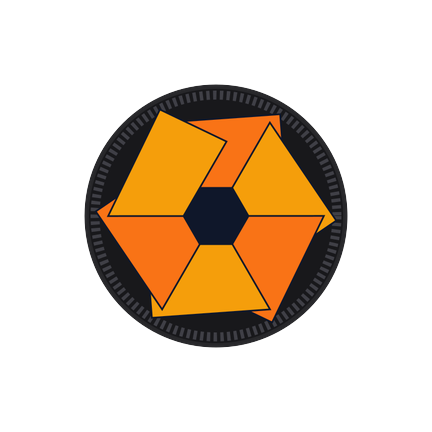
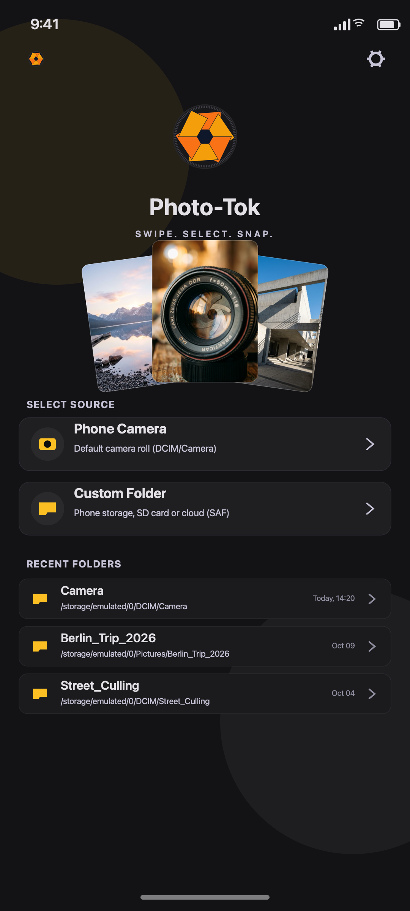
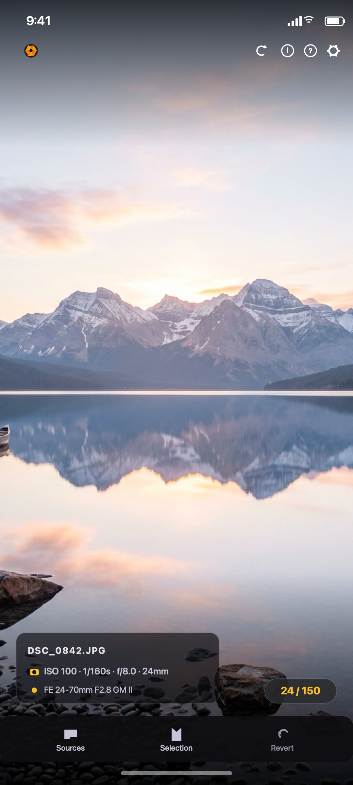
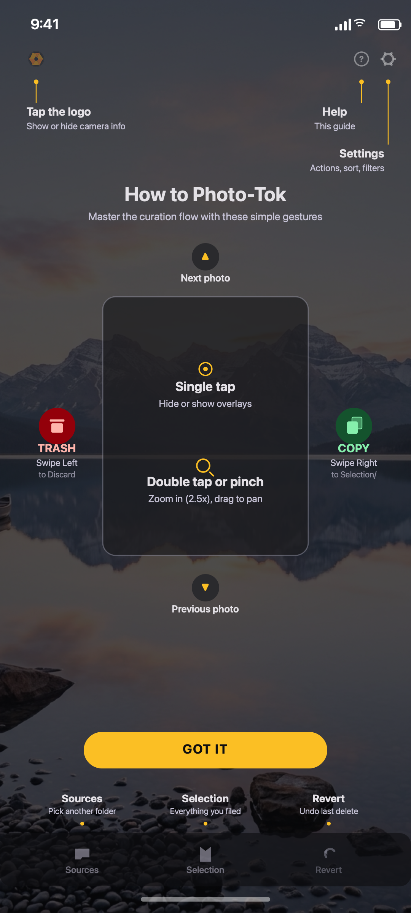
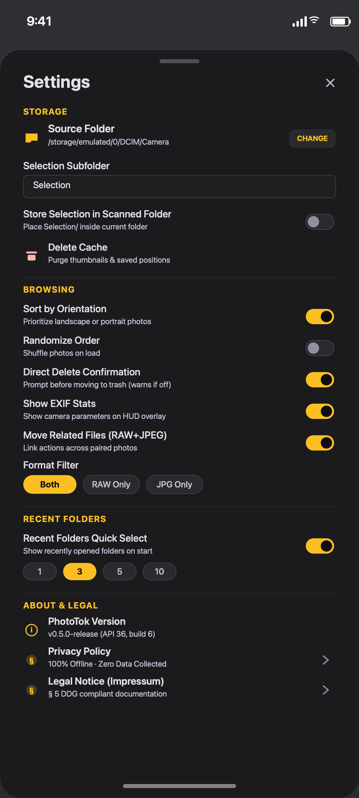

# 📱 PhotoTok (Android Phone)

<div align="center">
  

  ### Swipe. Select. Snap.
  **A lightweight, gesture-first, portrait photo curation app designed for sub-second time-to-first-swipe on Android phones.**

  [-3DDC84?logo=android&logoColor=white)](https://developer.android.com/)
  [](https://kotlinlang.org/)
  [](https://developer.android.com/jetpack/compose)
  [](#target-environment)
  [](#privacy--zero-cloud-guarantee)
  [](../../../LICENSE)
</div>

---

## 🌟 Visual Showcase

| 1. Landing & Recent Folders | 2. Full Viewer & Glassmorphic HUD |
| :---: | :---: |
|  |  |
| *Direct entry via Camera roll or SAF tree picker, tilted photo fan, and 1-tap recent folders.* | *Full-screen preview, glassmorphic EXIF card, live page counter pill, and persistent action bar.* |

| 3. In-Place Coach Marks Guide | 4. Configurable Settings & Privacy |
| :---: | :---: |
|  |  |
| *Translucent 70% scrim, leader lines pointing to real buttons, and animated directional gesture stage.* | *Customizable swipe destinations, RAW+JPEG link toggles, orientation sorting, and § 5 DDG legal links.* |

---

## 🚀 Product Overview

**PhotoTok** (`products/android/phototok/`, package `com.phototok`) is the phone-first photo culling application within the Photo Selector Toolbox ecosystem. It turns a familiar, effortless full-screen vertical swipe feed into a photography triage workflow.

While the desktop and tablet products emphasize multi-up comparative culling and computational quality scores (OpenCV / Accelerate), **PhotoTok deliberately omits heavy analysis libraries to optimize for a single metric: time-to-first-swipe.** Even folders containing thousands of high-resolution photos become navigable within a fraction of a second.

---

## 🎯 Key Features & Gestures

### 1. Vertical Pager Feed & Progressive Loading
*   **Compose Native `VerticalPager`:** Smooth, fluid scrolling between photos powered by `androidx.compose.foundation.pager.VerticalPager`.
*   **Predictive Coil Prefetching:** Pre-fetches high-resolution images within a radius of $\pm 3$ positions around the active viewport, ensuring stutter-free paging transitions.
*   **Progressive SAF Enumeration:** Emits a first batch after 24 photos, subsequent batches every 250 photos, rendering a live `${index + 1} / ${total}+` indicator while folder discovery streams in the background.

### 2. Tactile Culling Gestures
*   **Swipe-Right to File (`COPY` / `MOVE`):** Files the photo into the user's `Selection/` folder. Accompanied by a glowing green action badge and an animated confirmation checkmark flash.
*   **Swipe-Left to Discard or Route (`DELETE` / `COPY` / `MOVE`):** Configurable in Settings. Deletions show a progressive pulsing red trash icon, card tilt ($2^\circ$), and optional direct-delete confirmation dialog.
*   **Persistent Revert:** Deletions remain undoable across vertical scrolls via the viewer bottom bar **Revert** button (`RestoreFromTrash`, paired with visible micro-labels alongside **Sources** and **Selection**) until navigation away, folder switch, or subsequent file mutation.
*   **Non-Blocking Optimistic Execution:** Feed updates immediately upon gesture completion; file transfers run on the injected `@ApplicationScope`. Any failed mutation is cleanly re-inserted into the feed at its original slot.

### 3. Inspection & Tap Controls
*   **Single-Tap HUD Toggle:** Seamlessly shows or hides the camera EXIF panel, page counter pill, and action bars for an unobstructed view of the photo.
*   **Double-Tap Zoom to 2.5×:** Instant zoom centered on the tapped coordinate; double-tapping again resets to fit-screen.
*   **Pinch-to-Zoom & Pan:** Smooth two-finger zoom up to $6\times$ with single-finger panning when zoomed; paging and culling swipes are automatically disabled while inspecting fine details.

### 4. Smart Ingestion & Guidance
*   **Resume or Start with Newest Prompt (`FolderResumeDialog`):** When reloading PhotoTok (`Sync`) or opening a folder that has been opened before, PhotoTok reports whether newer photos were added since you last left, shows your saved position (`at photo #X of Y`), and lets you choose between **Continue Where I Left Off** and **Start with Newest**.
*   **In-Place Coach Marks Tutorial (`GestureTutorialOverlay`):** Contextual guide anchoring callouts directly to real chrome buttons without scrolling. Triggers automatically on first run, after 7+ days of inactivity, or on demand via the Help icon.
*   **RAW+JPEG Sibling Pairing:** Centered dialog detects companion RAW and JPEG files, allowing users to link operations across both formats (`moveRelatedFiles = true`) or filter by format. With linking on, a swipe-left delete takes the whole bundle (shown file and its siblings) out of the feed together, **Revert** brings all of it back in place, and a delete the file system refuses is reported by name and the photo returns to the feed. A move whose copy succeeded but whose original could not be removed keeps the photo in the feed and says so ("Copied to … — original could not be removed").
*   **Supported Formats:** JPEG, HEIF/HEIC, PNG, TIFF and WebP, plus camera RAW — Sony ARW, Canon CR2 and CR3, Nikon NEF and NRW, Fujifilm RAF, Panasonic RW2, OM System/Olympus ORF, Pentax PEF, DNG and Samsung SRW, with further RAW extensions (3FR, IIQ, RWL, SR2, MRW, X3F, ERF, MEF, …) recognised for discovery and pairing. Extensions match case-insensitively. RAWs are shown from the camera's embedded JPEG preview (no full RAW decode, so swiping stays fast); a RAW whose preview is smaller than 1024 px (phone DNGs) falls back to the platform decoder. The contract is `testdata/formats/manifest.json` ([docs/shared/SUPPORTED_FORMATS.md](../../shared/SUPPORTED_FORMATS.md)).
*   **Orientation-Aware Sorting & Shuffle:** Settings toggles allow prioritizing landscape or portrait orientations first, or shuffling the feed randomly.

---

## 🔒 Privacy & Zero-Cloud Guarantee

*   **100% Offline Processing:** `android.permission.INTERNET` is strictly absent from `AndroidManifest.xml`. Photos never leave your device.
*   **Zero Storage Permissions / Pure SAF:** Interacts with storage exclusively through Android's Storage Access Framework (`ACTION_OPEN_DOCUMENT_TREE` / `DocumentsContract`).
*   **No Proprietary Cloud SDKs:** No Google Sign-In, no Drive REST client, and no OAuth scopes. Cloud storage (such as Google Drive) is accessed solely via system document providers, eliminating CASA / OAuth verification risks.
*   **Compliance with § 5 DDG & GDPR:** Settings exposes direct legal links to Privacy Policy and Legal Notice (Impressum) matching `com.phototok.domain.LegalLinks`.

---

## 🏗️ Architecture & Specifications

| Property | Value |
| :--- | :--- |
| **Code Location** | `products/android/phototok/` |
| **Gradle Module** | `:phototok` |
| **Package Name** | `com.phototok` |
| **Application ID** | `com.phototok` |
| **minSdk / targetSdk / compileSdk** | 26 (Android 8.0) / 36 (Android 16) / 37 |
| **Target Device Class** | Portrait phones $< 600$ dp (Compact window size class) |
| **Shared Code** | `:core` (`products/android/core/`) for shared EXIF models |
| **Output Artifacts** | `phototok-android-release.apk` / `.aab` |

### Architectural Layering
*   **`data/`**: SAF implementations (`LocalImageSourceImpl`), DataStore persistence (`SettingsRepositoryImpl`, `RecentPathCodec`), and URI scheme resolution.
*   **`domain/`**: Pure Kotlin business logic free of Android SDK dependencies (`PhoneFeedOrdering`, `PendingDeleteLogic`, `OptimisticFeed`, `RelatedFiles`, `SwipeLabels`, `LegalLinks`).
*   **`ui/`**: Jetpack Compose screens (`PhoneModeLanding`, `PhoneModeViewer`, `GestureTutorialOverlay`, `SettingsScreen`) adhering to the Golden Hour studio dark theme.
*   **`viewmodel/`**: `PhoneModeViewModel`, `SettingsViewModel`, `SelectionViewerViewModel`.

---

## 🛠️ Build, Test & Verification

From `products/android`:

```bash
# Run JVM unit test suite
./gradlew :phototok:testDebugUnitTest

# Assemble debug APK
./gradlew :phototok:assembleDebug

# Assemble release APK and AAB bundle
./gradlew :phototok:assembleRelease
./gradlew :phototok:bundleRelease
```

Or from the repository root using the CI mirror:

```bash
# Verify all Android gates
./scripts/run_tests.sh --android

# Run full repository CI suite
./scripts/run_tests.sh
```

---

## 📚 Documentation Index

*   `REQUIREMENTS.md` (maintainer-private) — Authoritative behavioral requirements and architecture contracts.
*   [`RELEASE_CHECKLIST.md`](RELEASE_CHECKLIST.md) — Authoritative release checklist covering CI gates, local reproducible builds, and Play Console / F-Droid submission.
*   `LEGAL_COMPLIANCE.md` (maintainer-private) — German § 5 DDG Impressum, EU DSA Non-Trader, and GDPR compliance documentation.
*   [`ARCHITECTURE.md`](ARCHITECTURE.md) — Structural architecture, themes, and DataStore key specifications.
*   [`DESIGN.md`](DESIGN.md) — Visual design, M3 color tokens, component metrics, and gesture animations.
*   `UX_INVESTIGATION_REPORT.md` (maintainer-private) — Heuristic usability audit and persona evaluations.
*   [`../../shared/FEATURE_PARITY.md`](../../shared/FEATURE_PARITY.md) — Cross-product feature mapping across all 5 products.
