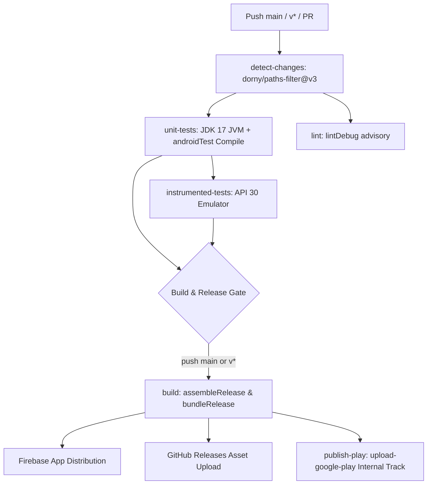

# PhotoTok Release Checklist & Deployment Guide

**Product**: PhotoTok (`:phototok`, `products/android/phototok/`)  
**Package Identifier**: `com.phototok`  
**License**: MIT  
**Current Version**: `0.5.0` (Version Code `6` base / CI dynamic)  
**Target API**: `36` (Android 16) | **Min SDK**: `26` (Android 8.0) | **Compile SDK**: `36`  
**Distribution Tracks**: GitHub Releases, F-Droid, Google Play (Closed Testing)

---

## 1. Automated CI Gates (`.github/workflows/android.yml`)

The Android continuous integration pipeline is defined in `.github/workflows/android.yml`. It provides automated validation, regression protection, and release packaging.



### 1.1 Pipeline Stages & Execution Conditions

| Stage | Trigger / Condition | Key Actions & Tools | Output / Artifacts |
|---|---|---|---|
| **`detect-changes`** | All triggers (push, PR, dispatch) | Evaluates file paths via `dorny/paths-filter@v3`. Monitors `products/android/phototok/**`, `products/android/core/**`, root Gradle scripts, and workflow YAML. | Outputs `phototok: true/false` |
| **`unit-tests`** | All triggers | Sets up JDK 17 (Temurin) with `gradle/actions/setup-gradle@v4`.<br>1. Executes `./gradlew testDebugUnitTest --stacktrace` (203 JVM unit tests, 0 failures).<br>2. Executes `./gradlew :phototok:assembleDebugAndroidTest` to fail fast on Kotlin/KSP test compilation errors without waiting for emulator boot. | HTML test reports (`products/android/phototok/build/reports/tests/testDebugUnitTest/`) |
| **`lint`** | All triggers (`continue-on-error: true`) | Executes `./gradlew :phototok:lintDebug --continue --stacktrace`. Validates Android resource usage, API levels, and manifest attributes. | HTML lint reports (`products/android/phototok/build/reports/lint-results-debug.html`) |
| **`instrumented-tests`** | All triggers (depends on `unit-tests`) | Runs on GitHub Actions Ubuntu runner with KVM acceleration enabled.<br>Uses `reactivecircus/android-emulator-runner@v2` targeting API 30 (`x86_64`, `google_apis`).<br>Executes `./gradlew :phototok:connectedDebugAndroidTest`.<br>Applies `-no-snapshot-save` to prevent teardown crashes. | Connected test reports |
| **`build`** | Push to `main`, tags `v*`, or manual dispatch | 1. Computes monotonic `VERSION_CODE` (see §1.2).<br>2. Compiles debug APK (`./gradlew assembleDebug`).<br>3. Decodes upload keystores from GitHub Secrets.<br>4. Compiles minified release APK (`./gradlew :phototok:assembleRelease`).<br>5. Compiles release bundle (`./gradlew :phototok:bundleRelease`).<br>6. Stages release binaries to `products/android/release-assets/`.<br>7. Publishes GitHub Release via `softprops/action-gh-release@v2`.<br>8. Distributes to Firebase App Distribution (`wzieba/Firebase-Distribution-Github-Action@v1`). | `phototok-android-release.apk`<br>`phototok-android-release.aab` |
| **`publish-play`** | Push to `main` or tags `v*` (depends on `build`) | Uses `r0adkll/upload-google-play@v1`. Authenticates via `PHOTOTOK_GP_SERVICE_ACCOUNT_JSON` and uploads `phototok-android-release.aab` directly to Google Play's `internal` track for package `com.phototok`. | Google Play Internal Track Release |

### 1.2 Monotonic Version Code Generation

Google Play requires that every uploaded App Bundle has a strictly higher `versionCode` than preceding uploads. When re-running a failed CI workflow run, reusing `github.run_number` causes upload rejection (`"Version code X has already been used"`).

The CI workflow computes a collision-free monotonic version code:

```bash
VERSION_CODE=$(( 10000 + ${{ github.run_number }} * 100 + ${{ github.run_attempt }} ))
```

*   **Run 78, Attempt 1**: `10000 + 7800 + 1 = 17801`
*   **Run 78, Attempt 2** (retry): `10000 + 7800 + 2 = 17802`
*   **Run 79, Attempt 1**: `10000 + 7900 + 1 = 17901`

Optional manual offsets can be configured via GitHub repository variables `PHOTOTOK_VERSION_CODE_OFFSET` or `VERSION_CODE_OFFSET` in `products/android/phototok/build.gradle.kts`:

```kotlin
val baseVersion = System.getenv("VERSION_CODE")?.toIntOrNull() ?: 6
val offset = System.getenv("PHOTOTOK_VERSION_CODE_OFFSET")?.toIntOrNull()
    ?: System.getenv("VERSION_CODE_OFFSET")?.toIntOrNull()
    ?: 0
versionCode = baseVersion + offset
```

---

## 2. Local Reproducible Builds & Verification

Release builds can be generated locally without external CI dependencies.

### 2.1 Build Prerequisites

*   **JDK**: OpenJDK 17 (Temurin or Corretto recommended). Verify with `java -version`.
*   **Android SDK**: Android 16 (API Level 36), Android SDK Build-Tools `36.0.0` or `35.0.0`.
*   **Gradle**: Bundled Gradle wrapper `9.5.1` (`gradle-9.5.1-bin.zip`).

### 2.2 Compilation Commands

Execute from the `products/android` directory:

```bash
# 1. Clean previous build artifacts (optional)
./gradlew clean

# 2. Build release APK (R8 minified, resource shrunk)
./gradlew :phototok:assembleRelease

# 3. Build release Android App Bundle (AAB for Google Play)
./gradlew :phototok:bundleRelease
```

### 2.3 Verified Build Outputs & Artifact Metrics

When executed without signing credentials, Gradle produces unsigned release artifacts:

| Artifact Type | Output Path | Approximate Size | Exact Bytes |
|---|---|---|---|
| **Release APK (Unsigned)** | `products/android/phototok/build/outputs/apk/release/phototok-release-unsigned.apk` | ~4.1 MB (3.93 MiB) | `4,118,209` bytes |
| **Release Bundle (AAB)** | `products/android/phototok/build/outputs/bundle/release/phototok-release.aab` | ~6.3 MB (6.04 MiB) | `6,332,509` bytes |
| **R8 Mapping Directory** | `products/android/phototok/build/outputs/mapping/release/` | ~34 MB | Contains `mapping.txt`, `seeds.txt`, `usage.txt`, `configuration.txt`, `resources.txt` |

### 2.4 R8 Minification & Resource Shrinking Architecture

PhotoTok enforces R8 code optimization and resource shrinking in `build.gradle.kts`:

```kotlin
buildTypes {
    release {
        isMinifyEnabled = true
        isShrinkResources = true
        proguardFiles(
            getDefaultProguardFile("proguard-android-optimize.txt"),
            "proguard-rules.pro"
        )
    }
}
```

#### Why Minification & Shrinking Are Essential
1. **App Size**: Strips unused Jetpack Compose, Kotlin runtime, and AndroidX classes, reducing APK download footprint from >18 MB to 4.1 MB.
2. **Resource Stripping**: Unused XML layouts, drawables, and string resources from transitive dependencies are removed from the packaged assets.
3. **Bytecode Obfuscation**: Renames non-public classes, methods, and fields into short tokens (`a`, `b`, `c`), providing defense-in-depth against decompilation.
4. **Crash De-obfuscation**: The generated `mapping.txt` must be retained with each release to symbolicate stack traces received via Google Play Console or bug reports.

#### ProGuard Rules References
1. **Module Rules** (`products/android/phototok/proguard-rules.pro`):
   ```proguard
   # Photo-Tok ProGuard rules
   -keepattributes *Annotation*
   -keep class dagger.hilt.** { *; }
   ```
   *   Preserves dependency injection metadata generated by Dagger Hilt.
   *   Retains Compose runtime annotations (`@Composable`, `@Stable`).
2. **Core Consumer Rules** (`products/android/core/`):
   ```proguard
   -keep class com.photoselector.core.model.** { *; }
   ```
   *   Protects domain models (`ExifData`, `MediaItem`) passed between modules.
3. **Reflection & Serialization Safety**:
   *   PhotoTok intentionally avoids reflective JSON libraries (GSON, Jackson, Moshi).
   *   Recent paths and settings use deterministic delimiter string encoding (`RecentPathCodec.kt`: ASCII `\u001E` Record Separator and `\u001F` Unit Separator).
   *   Coil image loader (`io.coil-kt:coil-compose`) loads local content/file URIs without network interceptors.

### 2.5 Local Signing & Signature Verification

To manually sign an unsigned APK for testing on physical devices:

```bash
# 1. Align the APK (if using build-tools zipalign)
zipalign -v -p 4 phototok-release-unsigned.apk phototok-release-aligned.apk

# 2. Sign using apksigner (APK Signature Scheme v2/v3/v4)
apksigner sign \
  --ks /path/to/phototok-upload.jks \
  --ks-key-alias phototok \
  --out phototok-release-signed.apk \
  phototok-release-aligned.apk

# 3. Verify signature integrity
apksigner verify --verbose --print-certs phototok-release-signed.apk
```

Expected `apksigner` output:
```
Verifies
Verified using v1 scheme (JAR signing): true
Verified using v2 scheme (APK Signature Scheme v2): true
Verified using v3 scheme (APK Signature Scheme v3): true
Verified using v4 scheme (APK Signature Scheme v4): false (optional)
Number of signers: 1
Signer #1 certificate DN: CN=PhotoTok, OU=Mobile, O=Alexander Patz, L=Berlin, ST=Berlin, C=DE
```

---

## 3. Mandatory Human Tasks — Google Play Console

While CI automates compilation and deployment, Google Play enforces strict human identity and onboarding policies.

### 3.1 Upload Keystore Generation

Generate the dedicated production upload keystore locally in a secure terminal. **Never commit the resulting `.jks` file to Git.**

```bash
keytool -genkeypair -v \
  -keystore phototok-upload.jks \
  -alias phototok \
  -keyalg RSA \
  -keysize 2048 \
  -validity 10000 \
  -dname "CN=PhotoTok, OU=Mobile, O=Alexander Patz, L=Berlin, ST=Berlin, C=DE"
```

Encode the keystore into base64 for GitHub Secrets:

```bash
# macOS
base64 -i phototok-upload.jks | tr -d '\n' | pbcopy

# Linux
base64 -w 0 phototok-upload.jks
```

### 3.2 GitHub Repository Secrets Setup

Navigate to **GitHub Repository Settings → Secrets and variables → Actions** and configure:

| Secret Name | Purpose | Example / Format |
|---|---|---|
| `PHOTOTOK_KEYSTORE_FILE` | Base64-encoded upload keystore | Output of `base64 -i phototok-upload.jks` |
| `PHOTOTOK_KEY_ALIAS` | Key alias within the keystore | `phototok` |
| `PHOTOTOK_KEY_PASSWORD` | Password for the key entry | Secure password |
| `PHOTOTOK_STORE_PASSWORD` | Password for the keystore file | Secure password |
| `PHOTOTOK_GP_SERVICE_ACCOUNT_JSON` | Google Cloud Service Account JSON key | Service account with "Release manager" permissions in Play Console API access |
| `PHOTOTOK_FIREBASE_APP_ID` (Variable) | Firebase App ID for tester distribution | `1:211786657248:android:...` |
| `PHOTOTOK_FIREBASE_APP_DISTRIBUTION_CREDENTIALS` | Service Account JSON for Firebase | Google Cloud credentials with Firebase App Distribution Admin role |

### 3.3 Google Play Developer Account Onboarding & KYC

1. **Account Registration**: Register a Google Play Developer account ($25 one-time registration fee).
2. **KYC Identity Verification**:
   *   Submit valid official government ID (Passport or German Personalausweis).
   *   Provide proof of residence (utility bill or bank statement within 90 days).
   *   Verify primary developer phone number and email address.
3. **Google Play App Signing**:
   *   Enroll in Google Play App Signing (mandatory for App Bundles).
   *   Google generates and securely holds the production app signing key; Google re-signs your app with that key before serving it to users.
   *   Your local `phototok-upload.jks` is used solely as an **Upload Key**.

### 3.4 Mandatory 14-Day 20-Tester Closed Testing Period

Under Google Play Policy (mandatory for personal developer accounts created after November 13, 2023), new apps cannot be published directly to Production without completing closed testing.

#### Testing Requirements & Timeline:
1. **Track Creation**: Create a **Closed Testing Track** (not Internal or Open) titled e.g. `Alpha / Closed Beta`.
2. **Tester Recruitment**: Recruit at least **20 distinct individuals** (personal contacts, photography community, Reddit /r/androidapps or /r/AndroidClosedTesting).
3. **Google Group / Email List**: Create a Google Group (e.g. `phototok-testers@googlegroups.com`) and add tester email addresses. Add the group to the Closed Track tester list in Play Console.
4. **Opt-in Verification**: Send testers the opt-in link:
   `https://play.google.com/apps/testing/com.phototok`
   Every tester must click **"Become a tester"** and install the app on an Android device.
5. **14 Continuous Days**: Maintain at least 20 active opted-in testers for **14 consecutive calendar days**. Do not pause the track or remove testers during this window.
6. **Production Access Questionnaire**: Once the 14 days elapse, submit the Production Access Request in Play Console. Prepare answers addressing:
   *   How testers were recruited.
   *   Feedback received during the test period.
   *   Fixes or refinements applied (referencing test iterations).
   *   Why the app is ready for open production distribution.

### 3.5 Google Play Data Safety Declaration

PhotoTok is a **100% offline, zero-network photo utility**. It requests **zero Android permissions** and has no analytics or third-party trackers.

Complete the Google Play Console Data Safety questionnaire with the following inputs:

| Question / Section | Form Answer | Justification / Architectural Evidence |
|---|---|---|
| **Does your app collect or share any of the required user data types?** | **No** | App does not request `android.permission.INTERNET`. Zero network communication. |
| **Is all user data collected by your app encrypted in transit?** | **N/A** | No data is collected or transmitted off-device. |
| **Do you provide a way for users to request data deletion?** | **N/A** | No user data or account records exist on any external server. |
| **Does your app handle Photos and Videos?** | **Locally Only** | User selects local folders via Android Storage Access Framework (`ACTION_OPEN_DOCUMENT_TREE`). Image data is read into local RAM/cache for culling and never uploaded. |
| **Location / Personal info / Financial / Health** | **No** | None accessed or stored. |
| **Device or other IDs** | **No** | No advertising IDs (`AD_ID`), GMS identifiers, or hardware IDs collected. |

### 3.6 Other Play Console Declarations

*   **Target Audience**: Age 13 and older (not directed to children under 13).
*   **Government / Financial / Health Apps**: Declare "No" to all government, COVID-19, loan, and health-related disclosures.
*   **Advertising ID (`AD_ID`)**: Declare that the app does not use the Advertising ID.
*   **Digital Services Act (DSA)**: Declare developer status as **Non-Trader** (see `docs/products/phototok/LEGAL_COMPLIANCE.md` for justification). This prevents forced public disclosure of your home address on the Play Store page.

### 3.7 Store Listing Assets & Text

*   **App Title**: `PhotoTok: Fast Photo Culler` (≤ 30 characters)
*   **Short Description**: `Lightning-fast, offline vertical photo selector and SD-card culler.` (≤ 80 characters)
*   **Full Description**: Must include the defensive trademark disclaimer:
    > *"PhotoTok is an independent, 100% offline photography tool and is not affiliated with, sponsored by, endorsed by, or in any way associated with TikTok, ByteDance Ltd., or their affiliates."*
*   **App Icon**: `512x512` PNG, 32-bit color, max 1024 KB.
*   **Feature Graphic**: `1024x500` JPEG or 24-bit PNG, max 15 MB.
*   **Phone Screenshots**: At least 4 high-resolution screenshots:
    1. Landing / Folder Selection Screen
    2. Vertical Fullscreen Photo Viewer (HUD active)
    3. First-Run Coach Marks / Gesture Tutorial
    4. Settings & Storage Preferences

---

## 4. F-Droid Submission Guide

F-Droid is the premier repository for Free and Open Source Android software. PhotoTok's architecture is uniquely optimized for F-Droid approval: zero proprietary dependencies, zero GMS, zero trackers, and zero network access.

### 4.1 F-Droid Compliance Checklist

| F-Droid Inclusion Criteria | Status | Evidence |
|---|---|---|
| **OSI-Approved Open Source License** | **Pass** | MIT License (`LICENSE` at repo root). |
| **Zero Proprietary Blobs** | **Pass** | All dependencies resolved from Maven Central / Google Maven; zero closed-source `.aar`/`.jar` binaries. |
| **Zero Google Play Services (GMS)** | **Pass** | No `play-services-*` or Firebase client libraries in app dependencies. |
| **Zero Trackers / Analytics** | **Pass** | Verified by Exodus Privacy standards: zero analytics SDKs, zero telemetry. |
| **Zero Anti-Features** | **Pass** | No `Ads`, `Tracking`, `NonFreeNet`, or `NonFreeDep` flags triggered. |
| **Reproducible Build Environment** | **Pass** | Gradle wrapper `9.5.1`, standard JDK 17, and clean headless build tasks. |

### 4.2 F-Droid Metadata Template (`metadata/com.phototok.yml`)

Submit a Merge Request to `gitlab.com/fdroid/fdroiddata` with the following recipe:

```yaml
Categories:
  - Graphics
  - Photography
License: MIT
AuthorName: Alexander Patz
SourceCode: https://github.com/alexpp90/photo-selector
IssueTracker: https://github.com/alexpp90/photo-selector/issues
Changelog: https://github.com/alexpp90/photo-selector/blob/main/CHANGELOG.md

Name: PhotoTok
Summary: Lightning-fast offline vertical photo selector and culler
Description: |
  PhotoTok brings modern vertical gesture navigation to photo culling.
  Designed for photographers reviewing camera rolls and SD-card imports:

  * High-speed vertical swiping through raw and JPEG photos
  * Quick swipe-to-select and swipe-to-reject workflows
  * Direct delete confirmation with 7-second revert window
  * Seamless Storage Access Framework (SAF) integration
  * 100% offline with zero network permissions or analytics

RepoType: git
Repo: https://github.com/alexpp90/photo-selector.git

AutoUpdateMode: Version v%v
UpdateCheckMode: Tags
CurrentVersion: 0.5.0
CurrentVersionCode: 6

Builds:
  - versionName: 0.5.0
    versionCode: 6
    commit: v0.5.0
    subdir: products/android
    gradle:
      - yes
    gradleflags:
      - :phototok:assembleRelease
    prebuild: sed -i -e 's/compileSdk = 36/compileSdk = 35/g' phototok/build.gradle.kts || true
```

*Note on `prebuild`*: If F-Droid's build server environment has not yet deployed Android SDK 36 (Android 16), the temporary `prebuild` sed adjustment allows fallback compilation against SDK 35 without code modification.

---

## 5. Direct GitHub Releases Distribution

For power users, testers, and distribution outside app stores, GitHub Releases offers immediate availability.

### 5.1 Release Packaging Procedure

1. **Tag the Release**:
   ```bash
   git tag -a v0.5.0 -m "Release v0.5.0: PhotoTok initial launch"
   git push origin v0.5.0
   ```
2. **Automated CI Generation**: The push to tag `v*` automatically triggers `.github/workflows/android.yml`, which compiles, signs (if secrets exist), and attaches release assets.
3. **Artifact Assets**:
   *   `phototok-android-release.apk` (Signed Release APK)
   *   `phototok-android-release.aab` (Release App Bundle)
4. **Publish Checksums**:
   Compute and publish SHA-256 checksums in the GitHub Release body:
   ```bash
   shasum -a 256 phototok-android-release.apk phototok-android-release.aab
   ```

---

## 6. End-to-End Release Sign-off Checklist

Use this checklist to track release readiness before promoting any build to public availability.

### Stage 1: Local Code & Verification Pre-Flight
- [ ] Working directory is clean (`git status` reports no untracked files or secret leaks).
- [ ] Unit tests pass: `./gradlew :phototok:testDebugUnitTest` (203 tests, 0 failures).
- [ ] Android Lint passes: `./gradlew :phototok:lintDebug` (0 errors).
- [ ] Instrumented test sources compile: `./gradlew :phototok:assembleDebugAndroidTest` (0 errors).
- [ ] Release binaries compile cleanly: `./gradlew :phototok:assembleRelease :phototok:bundleRelease`.
- [ ] Manifest audit confirmed: `products/android/phototok/AndroidManifest.xml` contains **zero** `<uses-permission>` tags.
- [ ] Target API verified: `targetSdk = 36` in `products/android/phototok/build.gradle.kts`.

### Stage 2: Legal & External Endpoints
- [ ] Privacy Policy endpoint is live: `https://alexpp90.github.io/phototok-legal/privacy-policy.html`.
- [ ] Impressum endpoint is live: `https://alexpp90.github.io/phototok-legal/impressum.html`.
- [ ] In-app URLs in `com.phototok.domain.LegalLinks` match live URLs.
- [ ] Trademark disclaimer is included in app description and legal documentation.

### Stage 3: CI Pipeline & Secrets
- [ ] Secrets provisioned in GitHub Repository Settings: `PHOTOTOK_KEYSTORE_FILE`, `PHOTOTOK_KEY_ALIAS`, `PHOTOTOK_KEY_PASSWORD`, `PHOTOTOK_STORE_PASSWORD`.
- [ ] Google Play Service Account secret provisioned: `PHOTOTOK_GP_SERVICE_ACCOUNT_JSON`.
- [ ] CI workflow executes successfully on `main` branch.

### Stage 4: Google Play Console Execution
- [ ] Developer account identity verification (KYC) complete.
- [ ] App entry `com.phototok` created in Play Console.
- [ ] Store listing assets uploaded (Icon, Feature Graphic, 4+ phone screenshots).
- [ ] Data Safety form submitted ("No data collected, no data shared").
- [ ] DSA status declared as "Non-Trader".
- [ ] App Content declarations submitted (Target age 13+, no ads, no government/health claims).
- [ ] Release AAB uploaded to Closed Testing track.
- [ ] 20 opt-in testers enrolled and active for 14 continuous days.
- [ ] Production access application submitted and approved.

### Stage 5: F-Droid & GitHub Releases Execution
- [ ] Git tag `v0.5.0` created and pushed.
- [ ] GitHub Release published with release notes, signed APK, and SHA-256 checksums.
- [ ] F-Droid merge request opened against `gitlab.com/fdroid/fdroiddata` with `metadata/com.phototok.yml`.
